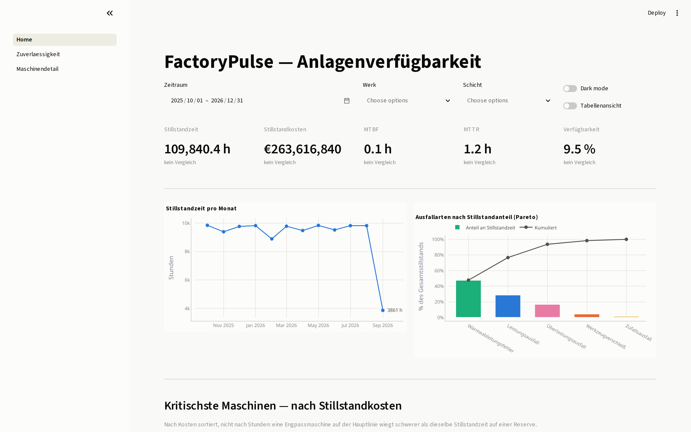

<h1 align="center">FactoryPulse</h1>

<p align="center">
  A manufacturing reliability lakehouse on Azure.<br/>
  Roughly 10 million sensor readings from 20 machines across 2 plants, ingested incrementally,
  modelled into a star schema with SCD Type 2 history, governed by Unity Catalog,
  and served through a Python dashboard that answers one question:
  <b>which machine do I fix first?</b>
</p>

<p align="center">
  
  
  
  
  
  
  
  
  
  
  
  
</p>

<p align="center">
  <a href="https://github.com/Mohamed-Elsafty23/FactoryPulse/actions/workflows/ci.yml">
    </a>
</p>

---

## Contents

- [How it works](#how-it-works) · [The dashboard](#the-dashboard) · [Data model](#data-model)
- [Tech stack](#tech-stack) · [The data](#the-data) · [Results](#results)
- [Infrastructure](#infrastructure) · [Data quality](#data-quality)
- [Decisions](#decisions) · [What this project doesn't do well](#what-this-project-doesnt-do-well)
- [Quick start](#quick-start) · [Cost](#cost) · [Docs](#docs)

---

## How it works

<p align="center">
  <a href="docs/diagrams/pipeline_animated.webm">
    
  </a>
</p>

<p align="center"><i>
Higher quality: <a href="docs/diagrams/pipeline_animated.webm">WebM</a> ·
<a href="docs/diagrams/pipeline_animated.mp4">MP4</a>.
This isn't a screen recording — it's rendered from
<a href="docs/diagrams/pipeline_animated.html">one HTML file</a> with <code>make diagrams</code>,
so it lives in version control and gets re-rendered whenever the architecture changes.
</i></p>

The short version, left to right:

1. The AI4I 2020 dataset (10k real rows) supplies sensor distributions and the failure taxonomy.
   A seeded PySpark simulator expands that into ~10M readings, with defects injected on purpose
   so the quality gates have something to catch.
2. Machines, work orders and production orders live in Azure SQL. A trigger bumps `updated_at`
   on every write, and that column is the watermark everything downstream trusts.
3. One parameterised Data Factory pipeline reads `ops.ingestion_control` and copies only the rows
   inside a closed watermark window. One pipeline, N tables, plus a re-runnable backfill.
4. Parquet lands in ADLS Gen2. The watermark only moves forward if the copy actually succeeded.
5. **Bronze** keeps the raw rows untouched and adds four lineage columns. No business logic.
6. **Silver** validates, deduplicates, and sends rejects to quarantine *with a reason attached*.
7. **Gold** builds the star schema: SCD2 `dim_machine` through a Delta MERGE, downtime intervals
   through gaps-and-islands.
8. The dashboard reads committed Parquet with DuckDB, so it still works when Azure is switched off.

Databricks Workflows runs `bronze → silver → scd2 → gold → quality`. There's a schedule, and it's
paused on purpose — an unattended 2 a.m. cluster is the easiest way to burn an Azure credit.

Every Azure resource above is created by Terraform.

---

## The dashboard

<p align="center">
  
</p>

Three pages, no login, no BI licence, no Azure. It queries the Parquet files committed in
`exports/`, which means you can clone this repo and have it running in about a minute:

```bash
pip install -e ".[dashboard]" && make dashboard    # http://localhost:8501
```

- **Plant manager** — is this period worse than the last, and who do I send a technician to?
  Five KPIs against the previous period, a downtime trend, a failure Pareto, and machines
  ranked by **cost** rather than hours. That ranking came straight out of the requirements
  conversation: a bottleneck machine going down matters more than a spare doing the same.
- **Reliability** — where should engineering spend its week? Failure modes by share of downtime,
  failure rate by shift and plant, and machines that keep breaking.
- **Machine detail** — one machine, including the full SCD2 version history when its attributes
  have changed over time.

Every chart has a table-view toggle. That isn't decoration: three of the five categorical colours
fall below 3:1 contrast against the light background, and a contrast warning obliges you to
provide another way to read the data. The palette itself was run through a validator rather than
eyeballed — the numbers are in [docs/metrics.md](docs/metrics.md).

<details>
<summary>More screenshots</summary>

| | |
|---|---|
| [Reliability](docs/evidence/dashboard/02_page2_reliability.png) | [Machine detail with SCD2 history](docs/evidence/dashboard/03_drilldown.png) |
| [Table view](docs/evidence/dashboard/04_table_view.png) | [Dark mode](docs/evidence/dashboard/05_dark_mode.png) |

</details>

---

## Data model

| Table | One row per | Rows |
|---|---|--:|
| `fact_machine_event` | machine, per minute | 9,896,841 |
| `fact_downtime` | continuous period a machine wasn't producing | 100,228 |
| `fact_work_order` | maintenance work order | 2,256 |
| `agg_machine_daily` | machine per day — stores KPI components, not ratios | 6,960 |
| `dim_machine` | machine *version* (SCD Type 2) | 21 rows / 20 machines |
| `dim_date`, `dim_plant`, `dim_shift`, `dim_failure_type` | conformed dimensions | 457 / 2 / 3 / 6 |

The grain is written as a table comment on every fact, so it shows up in Catalog Explorer,
in `DESCRIBE`, and in catalog search instead of only in a README nobody has open at the time.

```
 SOURCES              BRONZE                SILVER                   GOLD                CONSUMPTION
┌───────────┐   ┌──────────────┐   ┌──────────────────┐   ┌──────────────────────┐   ┌─────────────┐
│ AI4I 2020 │──→│ telemetry    │──→│ telemetry        │──→│ fact_machine_event   │──→│ DuckDB      │
│ simulator │   │ machines     │   │ work_orders      │   │ fact_downtime        │   │ Streamlit   │
│ Azure SQL │   │ work_orders  │   │ production_orders│   │ fact_work_order      │   │ Plotly      │
│ (via ADF) │   │ plants       │   │                  │   │ dim_machine (SCD2)   │   └─────────────┘
└───────────┘   │              │   │   ↓ rejects      │   │ dim_date/plant/shift │
                │ raw +        │   │ ┌──────────────┐ │   │ agg_machine_daily    │
                │ lineage cols │   │ │ quarantine   │ │   └──────────────────────┘
                └──────────────┘   │ │ + reason     │ │
                                   │ └──────────────┘ │
                                   └──────────────────┘
                     ops.pipeline_runs — every run, on success AND failure
```

---

## Tech stack

| Layer | Tool | Why |
|---|---|---|
| Source data | AI4I 2020 (UCI) | 10k real rows: sensor distributions and a five-mode failure taxonomy |
| Simulation | PySpark, seeded | expands to ~10M rows, reproducibly |
| Source system | Azure SQL | serverless with auto-pause; triggers maintain the watermark |
| Ingestion | Azure Data Factory | one metadata-driven pipeline for all tables, plus backfill |
| Storage | ADLS Gen2 | hierarchical namespace gives Delta the atomic renames it needs |
| Compute | Databricks serverless jobs | tasks start in 2–4 s and there's nothing to forget to shut down |
| Table format | Delta Lake | ACID, MERGE, time travel, schema enforcement |
| Governance | Unity Catalog | dev/prod catalogs, grants for 3 personas, comments, column lineage |
| Orchestration | Databricks Workflows | 5-task DAG, fails fast, schedule paused by default |
| Semantic layer | DuckDB + Python | SQL over Parquet, and unlike DAX you can unit-test it |
| Dashboard | Streamlit + Plotly | 3 pages, drill-down, validated palette |
| IaC | Terraform | 69 resources; `plan` comes back clean |
| CI | GitHub Actions | ruff + pytest on local Spark, no cloud credentials needed |
| Local dev | Docker Compose | Postgres and MinIO stand in for Azure SQL and ADLS |

---

## The data

The sensor distributions and failure rules are real, from the
**AI4I 2020 Predictive Maintenance** dataset (UCI, CC BY 4.0) — 10,000 rows. Everything beyond
that is simulated: 20 machines, 2 plants, 3 shifts, about 12 months at one-minute resolution.
The simulator implements AI4I's documented generative rules rather than sprinkling noise around,
and it deliberately injects duplicates, out-of-range values, orphan keys and missing fields so
the quality gates are tested against something.

One caveat, since it affects the headline numbers: the simulator applies AI4I's per-observation
failure probability once per *minute*. That reproduces the published per-reading failure rate,
but it makes the derived reliability KPIs unrealistic. Details in
[what this project doesn't do well](#what-this-project-doesnt-do-well).

---

## Results

From a green end-to-end run on 2026-10-19. These are measurements, not estimates.

| | |
|---|--:|
| Rows into Bronze | 10,049,501 |
| Rows surviving to Silver | 9,896,841 |
| Removed in Silver (rejects + duplicates) | 152,660 |
| `fact_machine_event` | 9,896,841 |
| Silver vs Gold | **exact match** |
| `fact_downtime` intervals | 100,228 |
| Bronze → quality, end to end | **6 m 37 s** |
| Serverless task start-up | 2–4 s |
| Data-quality checks passing | **10 / 10** |
| Tests | **59 passing** |
| Partition pruning speed-up | **1.40×** (0.734 s → 0.524 s) |
| Terraform resources | 69 |
| Azure spend | **$3.24** of a $200 credit |
| Dashboard hosting | **$0** |

That 1.40× is lower than the 10×+ you often see quoted, and I left it as measured rather than
picking a friendlier query. [docs/benchmarks.md](docs/benchmarks.md) has the hardware, the
method, the physical plan showing `PartitionFilters`, and an explanation of why the margin is
small at this data size.

---

## Infrastructure

```bash
make tf-apply-stage1   # first run only, bootstraps the Databricks workspace
make tf-apply          # everything else
make tf-destroy        # billing stops
```

<details>
<summary>What's in Terraform, what isn't, and the rough edges</summary>

Terraform owns the resource group and budgets (created *before* anything billable, enforced with
`depends_on`), ADLS Gen2, Key Vault and its RBAC, Azure SQL, Data Factory with its linked services
and datasets, the Databricks workspace, cluster, job, secret scope and volume, and all of Unity
Catalog including the grants.

It deliberately doesn't own:

- **ADF pipeline activities.** The JSON lives in `infra/terraform/adf_pipelines/` and is deployed
  through `activities_json`. Nested activity JSON written as HCL is unreadable.
- **Database schema and seed data.** That's data, not infrastructure.
- **The dashboard.** It's a Python app in this repo.
- **Databricks account-level groups.** They need a separate account-level provider; for three
  groups that wasn't worth the machinery.

Rough edges I'd rather name than hide:

- **The first apply takes two stages.** The Databricks provider needs the workspace URL, which
  doesn't exist until the workspace does, and Terraform configures providers before it walks the
  graph. The proper fix is two root modules wired together with `terraform_remote_state`. That's
  more structure than a solo project needs, so there's a `-target` bootstrap step instead.
- **State holds secrets in plaintext.** `random_password` values end up in `terraform.tfstate`.
  It's gitignored; a team would use an encrypted remote backend with locking.
- **`time_sleep` waits for RBAC propagation.** Azure role assignments take 30–120 s to take
  effect and Terraform can't wait on that natively. Common, still a workaround.
- **Job tasks are declared alphabetically** rather than in DAG order, because the provider reads
  them back sorted and any other order produces a permanent diff on every plan.

</details>

---

## Data quality

Ten checks run on every pipeline execution and in CI:

| # | Check | What it catches |
|---|---|---|
| 1 | `event_id` is unique | a dedup that quietly failed, inflating every SUM |
| 2 | no orphan `machine_id` | facts that disappear from grouped reports |
| 3 | sensors within physical ranges | faults dressed up as measurements |
| 4 | no negative durations | clock skew flattering MTTR |
| 5 | `failure_type` in the known set | upstream schema drift |
| 6 | no duplicate rows after dedup | dedup doing nothing at all |
| 7 | Silver and Gold row counts reconcile | a point-in-time join fanning out or dropping rows |
| 8 | no overlapping SCD2 intervals | double-counted measures |
| 9 | exactly one current row per machine | machines vanishing from "today" |
| 10 | re-running changes no counts | retries corrupting totals |

Checks 7 and 9 paid for themselves while porting to Azure. Check 7 caught a point-in-time join
quietly dropping 2.6M rows; check 9 caught a machine sitting on two open SCD2 versions. Neither
raises an error on its own. The pipeline finishes green and the numbers are simply wrong, which
is the failure mode worth building a gate for.

Rejected rows go to quarantine with a reason rather than disappearing:

```sql
SELECT reject_reason, COUNT(*) FROM quarantine.telemetry GROUP BY 1 ORDER BY 2 DESC;
```

Every run writes to `ops.pipeline_runs` — on failure too — with rows read, written and rejected,
duration, freshness, and the git SHA that produced it.

---

## Decisions

The full log with alternatives is in [docs/decisions.md](docs/decisions.md). A few worth
pulling out:

**MTBF is non-additive, and a test enforces it.** It's computed as a ratio of sums at query
time, and Gold stores the *components* rather than a pre-computed ratio, so the usual bug —
averaging per-machine MTBF — isn't expressible. `test_mtbf_is_non_additive` fails CI if someone
"simplifies" it later. This is the clearest thing a code semantic layer buys you over DAX.

**SCD2 validity comes from the source change time, not load time.** `ops.machines.updated_at`
dates each version, and the earliest version is anchored at the beginning of time because a full
extract only shows current state and says nothing about what came before it. Getting this wrong
put every fact before `valid_from` and emptied the fact table completely. Three regression tests
now hold it in place.

**Validation rules are contextual.** A stopped machine reports 0 rpm, and that's correct data,
so range checks only apply while a machine is running. Without that scoping you quarantine
perfectly good rows and end up with an empty `fact_downtime`.

**Watermarks advance on Success, never on Completion.** Advancing on completion skips rows
permanently and silently. It's the classic incremental-ingestion data-loss bug, and the window's
upper bound is captured before the copy so a retry is safe.

**Overwrite mode is set per write, not on the session.** Databricks serverless rejects
`spark.sql.sources.partitionOverwriteMode` outright, and correctness-critical behaviour
shouldn't depend on ambient session state anyway.

**No dual-axis charts.** The Pareto indexes both series to percent of the same total so they
share one axis. Two y-scales aligned arbitrarily imply a relationship that isn't in the data.

---

## What this project doesn't do well

**The headline reliability KPIs aren't plant-realistic.** This is the big one. The simulator
applies AI4I's ~3.4% failure rate per minute-reading, but in the source dataset that rate is per
discrete manufacturing observation, not per minute of runtime. The result is a failure roughly
every 29 minutes per machine, and with 15–120 minute repairs the fleet sits DOWN about 70% of
the time. Fleet MTBF reads 0.12 h and availability 9.5%, where a real plant would be 200–400 h
and 85–95%.

The data is internally consistent (`running_minutes + downtime_minutes = reading_count`) and
every mechanism downstream — star schema, SCD2, gaps-and-islands, the quality gates — processes
it correctly. Fixing it means turning that per-observation probability into a per-minute hazard
and regenerating the dataset. It's a modelling choice in the simulator, not a pipeline defect,
and I'd rather say so than quietly present the numbers as plausible.

Smaller things:

- **Quarantine is append-only**, so re-running Silver re-appends the same rejects. The 310,944
  rows there span several runs. `_quarantine_batch` tells them apart; production would partition
  by batch or MERGE on a key.
- **ADF uses `SELECT *`**, so a renamed source column reaches Bronze before anything complains.
  The schema contract catches it at the SCD2 boundary, but an explicit column list would catch
  it a layer earlier.
- **Freshness reflects the simulation window**, not pipeline lag, because the dataset is
  historical. The mechanism works; the number isn't meaningful. See ADR-004.
- **Seeding is row-by-row** and slow. Bulk loading would fix it, and at this scale it didn't
  matter enough to do.
- **OEE uses simulated ideal cycle times** per machine model rather than measured ones.
- **The dashboard isn't self-service.** Power BI would give business users their own views and
  row-level security. I picked Python for reproducibility, testability, and because it outlives
  the Azure subscription — a trade, not an oversight.
- **`fact_machine_event` isn't committed** (~165 MB). `make simulate` regenerates it; the
  simulator is seeded. The aggregates and dimensions are in `exports/`.

---

## Quick start

Everything below runs locally. No Azure account, no cost.

```bash
git clone https://github.com/Mohamed-Elsafty23/FactoryPulse && cd FactoryPulse
make setup                       # venv, dependencies, pre-commit
make up                          # Postgres + MinIO
make seed                        # reference data
python -m factorypulse.simulator.change_events   # SCD2 change events
make simulate ROWS=1000000       # 1M rows is plenty for a first run
factorypulse run                 # bronze -> silver -> scd2 -> gold -> quality
make quality                     # the ten checks
```

You'll need Python 3.10–3.13, Java 17 and Docker.

**The dashboard**, which needs none of the above — it reads the committed Parquet:

```bash
pip install -e ".[dashboard]"
make dashboard                   # http://localhost:8501
```

**On Databricks**, if you have the infrastructure deployed:

```bash
make dbx-deploy                  # build the wheel, upload it, import notebooks, sync the job
make dbx-run                     # ...and trigger the medallion job, then wait for it
make exports                     # pull the Gold snapshot back down for the dashboard
```

Auth is your Azure CLI identity exchanged for a Databricks token. No PAT sitting on disk.

**Or just look at the data**, with nothing installed but pandas:

```python
import pandas as pd

pd.read_parquet("exports/gold_fact_downtime/")
pd.read_parquet("exports/ops_pipeline_runs/")
```

---

## Cost

$3.24 of a $200 Azure credit, as of 2026-10-19.

| Service | Cost |
|---|--:|
| Azure SQL (serverless, auto-pause) | $2.16 |
| Data Factory (activity runs) | $1.08 |
| ADLS Gen2 (Standard LRS, ~1 GB) | $0.00 |
| Databricks (serverless jobs) | $0.00 * |
| Dashboard hosting | $0.00 |

\* Databricks serverless billing is reported on a lag, so that line understates the final figure.
It stays small by construction: job compute is created per run and destroyed when the run ends,
so there's nothing to leave running, and the interactive cluster has a 10-minute
auto-termination that a Terraform `validation` block refuses to let anyone raise above 30.

Budget alerts were created before the first billable resource, ordered with `depends_on` so the
sequence can't be got wrong by accident. The first few weeks of the build ran entirely on Docker
and cost nothing.

---

## Docs

| | |
|---|---|
| [Build guide](docs/build/00_START_HERE.md) | every phase, with the reasoning behind each step |
| [KPI dictionary](docs/kpi_dictionary.md) | formula, owner, refresh frequency, German term |
| [Semantic layer](docs/metrics.md) | each metric and why it's written that way |
| [Data model](docs/data_model.md) | bus matrix, fact grains, SCD2 design |
| [Data provenance](docs/data_provenance.md) | what's real, what's simulated |
| [Benchmarks](docs/benchmarks.md) | measured numbers and the mechanism behind them |
| [Decisions](docs/decisions.md) | ADRs |

---

## Project layout

```
factorypulse/
├── infra/terraform/     the entire Azure platform as code
├── infra/docker/        local Postgres + MinIO
├── src/factorypulse/
│   ├── config.py        the one place that knows local paths from Azure paths
│   ├── spark.py         session builder; the only module that knows about JARs
│   ├── simulator/       AI4I profiling, telemetry generation, defect injection
│   ├── pipeline/        bronze, silver, scd2, gold, dimensions
│   ├── quality/         validation rules, schema contract, the ten checks
│   ├── dashboard/       DuckDB access, semantic layer, theme, charts
│   └── utils/           run context, ops table
├── app/                 Streamlit dashboard
├── notebooks/           thin Databricks wrappers over src/
├── tests/               unit, data-quality and metrics tests; no cloud needed
├── sql/                 Postgres and Azure SQL schemas
├── exports/             Gold tables as Parquet, explorable without Azure
├── scripts/             deploy, benchmarks, profiling, env bridging
└── docs/                build guide, diagrams, ADRs, dictionaries
```

---

## License

Code is MIT. The AI4I 2020 dataset is CC BY 4.0, from the UCI Machine Learning Repository.
