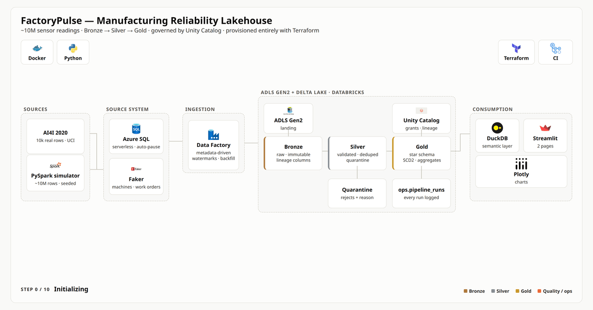
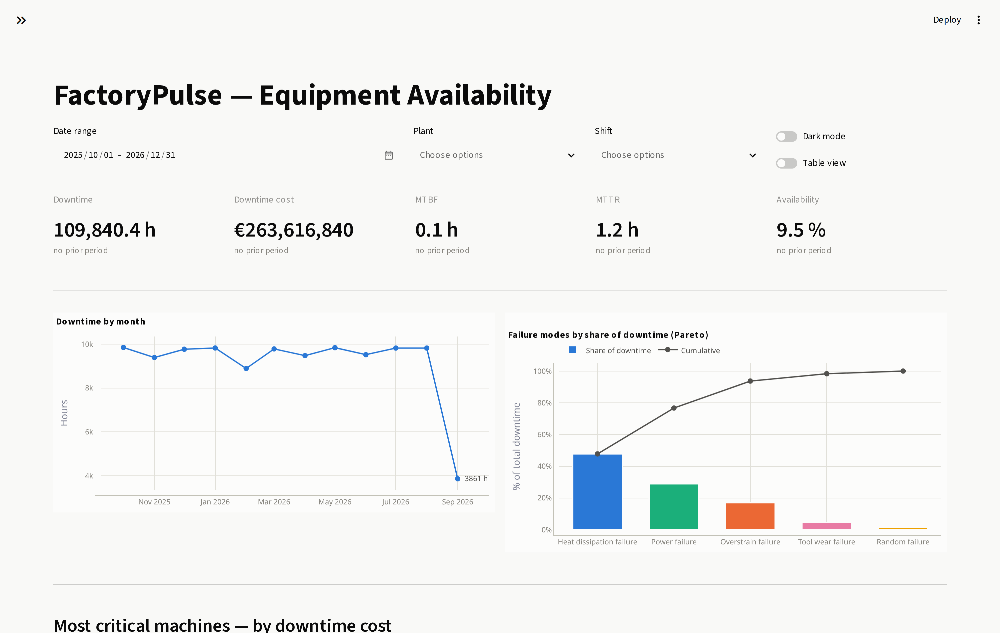
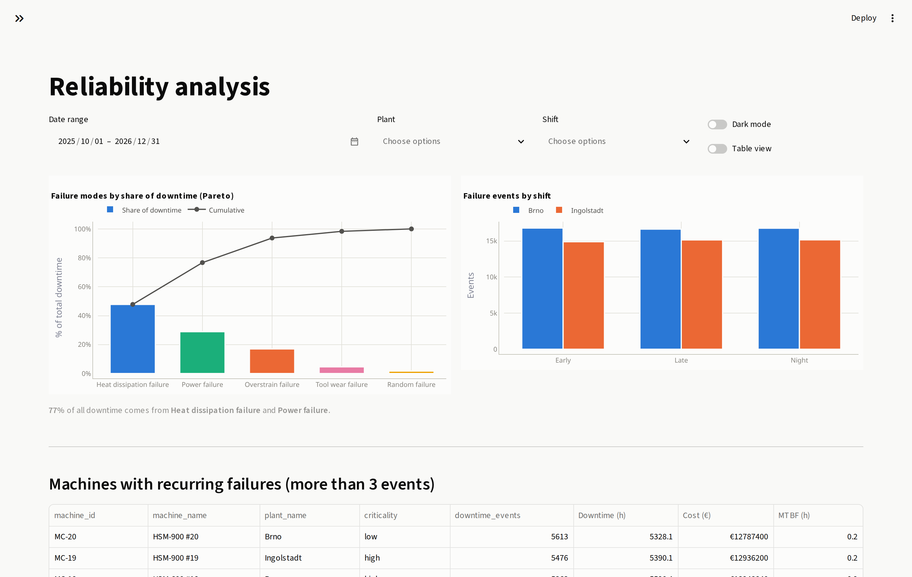
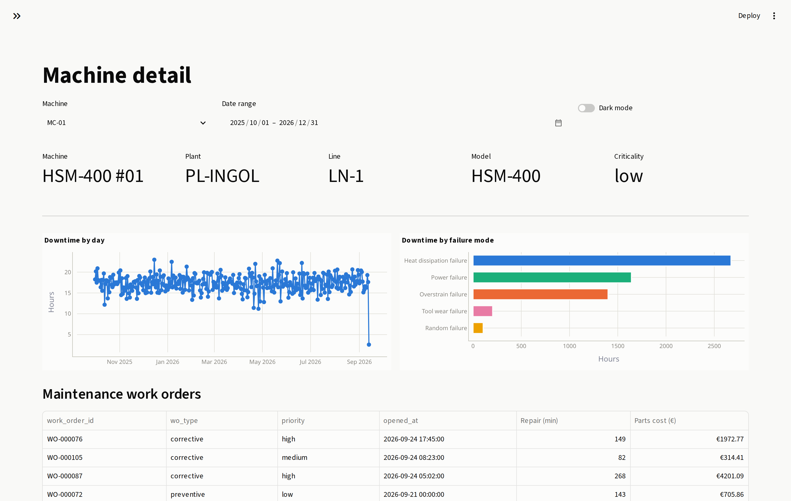
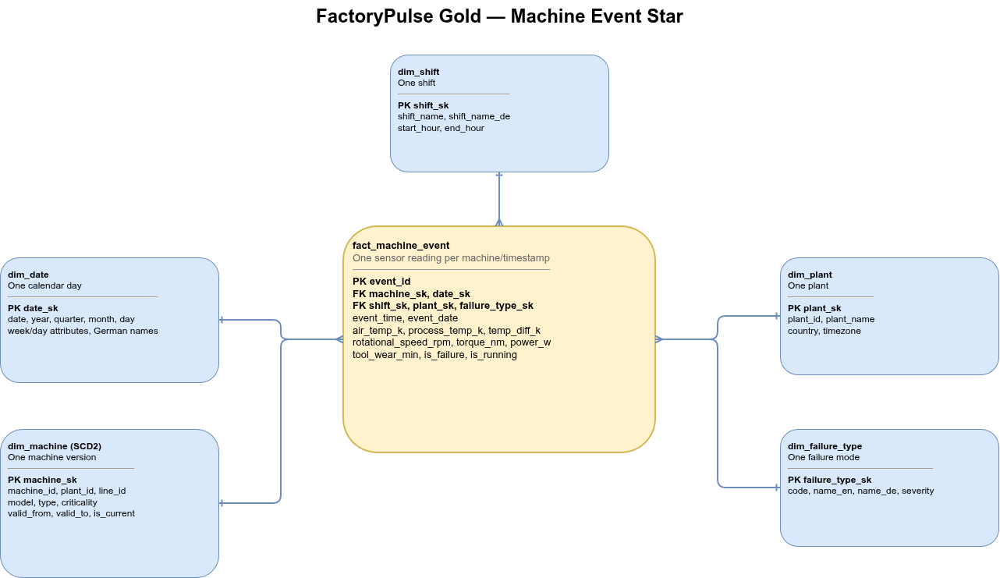
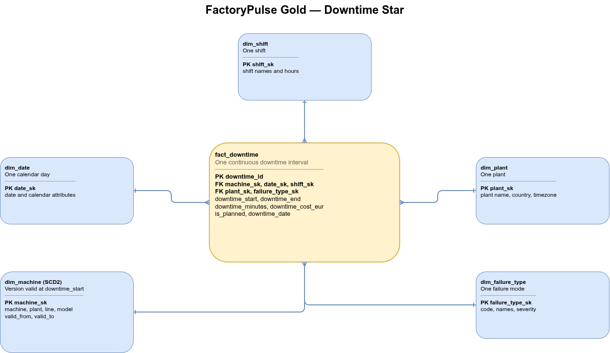

<h1 align="center">FactoryPulse</h1>

<p align="center">
  An end-to-end manufacturing reliability lakehouse on Azure.<br/>
  ~10M sensor readings · incremental ingestion · star schema with SCD Type 2 ·
  Unity Catalog governance · tested Python dashboard.
</p>

<p align="center">
  
  
  
  
  
  
  
  
  
  
  
  
</p>

<p align="center">
  <a href="https://github.com/Mohamed-Elsafty23/FactoryPulse/actions/workflows/ci.yml">
    </a>
</p>

---

## Summary

| | |
|---|---|
| **Scale** | 10,049,501 rows ingested, 9,896,841 through to Gold |
| **Runtime** | 6 m 37 s end to end on Databricks serverless |
| **Infrastructure** | 69 Terraform resources, `plan` clean |
| **Quality** | 10 data-quality gates, 68 tests, CI green |

Built across 16 phases: local Docker development, Azure provisioning, metadata-driven
ingestion, medallion transformation, governance, and a dashboard that runs without Azure.

---

## Pipeline

<p align="center">
  <a href="docs/diagrams/pipeline_animated.webm">
    
  </a>
</p>

<p align="center"><i>
<a href="docs/diagrams/pipeline_animated.webm">WebM</a> ·
<a href="docs/diagrams/pipeline_animated.mp4">MP4</a> ·
rendered from <a href="docs/diagrams/pipeline_animated.html">HTML</a> with <code>make diagrams</code>,
not screen-recorded.
</i></p>

| Stage | What happens |
|---|---|
| **Source** | AI4I 2020 (10k real rows) supplies sensor distributions and the failure taxonomy. A seeded PySpark simulator expands this to ~10M readings with defects injected deliberately. |
| **Azure SQL** | Machines, work orders, production orders. A trigger maintains `updated_at`, used downstream as the watermark. |
| **Data Factory** | One parameterised pipeline driven by `ops.ingestion_control`. Copies only rows inside a closed watermark window. Watermark advances on Success only. |
| **Bronze** | Raw rows plus four lineage columns. No business logic. |
| **Silver** | Validation, deduplication. Rejects go to quarantine with a reason attached. |
| **Gold** | Star schema. SCD2 `dim_machine` via Delta MERGE, downtime intervals via gaps-and-islands. |
| **Serving** | DuckDB over committed Parquet, Streamlit dashboard. No Azure dependency. |

Orchestrated by Databricks Workflows (`bronze → silver → scd2 → gold → quality`), scheduled
and paused by default. All Azure resources are Terraform-managed.

---

## Dashboard

```bash
pip install -e ".[dashboard]" && make dashboard    # http://localhost:8501
```

Reads the Parquet files committed in `exports/`, so it runs with Azure fully torn down.

**Plant manager** — five KPIs against the prior period, downtime trend, failure Pareto,
and machines ranked by cost rather than hours.

<p align="center">
  
</p>

**Reliability** — failure modes by share of downtime, failure rate by shift and plant,
and machines with recurring failures.

<p align="center">
  
</p>

**Machine detail** — single-machine drill-down including full SCD Type 2 version history.

<p align="center">
  
</p>

Every chart has a table-view toggle. The categorical palette was validated for colour-vision
deficiency with a checker rather than chosen by eye; results are in [docs/metrics.md](docs/metrics.md).

---

## Data model

| Table | Grain | Rows |
|---|---|--:|
| `fact_machine_event` | machine per minute | 9,896,841 |
| `fact_downtime` | continuous non-producing interval | 100,228 |
| `fact_work_order` | maintenance work order | 2,256 |
| `agg_machine_daily` | machine per day; stores KPI components, not ratios | 6,960 |
| `dim_machine` | machine version (SCD Type 2) | 21 rows / 20 machines |
| `dim_date` · `dim_plant` · `dim_shift` · `dim_failure_type` | conformed | 457 / 2 / 3 / 6 |

Grain is set as a table comment on every fact, so it appears in Catalog Explorer, `DESCRIBE`
and catalog search.

Two conformed stars share `dim_machine`, `dim_date`, `dim_plant` and `dim_shift`:

<p align="center">
  
</p>

<p align="center">
  
</p>

Facts join `dim_machine` on `machine_sk`, the version-specific surrogate key, never on
`machine_id` — a point-in-time join on the business key would fan out across SCD2 versions.

---

## Stack

| Layer | Technology |
|---|---|
| Ingestion | Azure Data Factory — metadata-driven, watermarked, with backfill |
| Storage | ADLS Gen2 + Delta Lake |
| Compute | Databricks serverless jobs (2–4 s task start-up) |
| Governance | Unity Catalog — dev/prod catalogs, grants for 3 personas, column lineage |
| Orchestration | Databricks Workflows |
| Transformation | PySpark 3.5 |
| Semantic layer | DuckDB + Python, unit-tested |
| Dashboard | Streamlit + Plotly |
| IaC | Terraform (69 resources) |
| CI | GitHub Actions — ruff + pytest on local Spark, no cloud credentials |
| Local dev | Docker Compose — Postgres and MinIO replace Azure SQL and ADLS |

---

## Results

Measured on a green end-to-end run, 2026-10-19.

| | |
|---|--:|
| Rows into Bronze | 10,049,501 |
| Rows into Silver | 9,896,841 |
| Removed in Silver (rejects + duplicates) | 152,660 |
| `fact_machine_event` | 9,896,841 |
| Silver vs Gold reconciliation | **exact match** |
| `fact_downtime` intervals | 100,228 |
| End-to-end runtime | **6 m 37 s** |
| Data-quality checks | **10 / 10** |
| Tests | **68 passing** |
| Partition pruning speed-up | **1.40×** (0.734 s → 0.524 s) |

Method, hardware and the physical plan behind the pruning figure are in
[docs/benchmarks.md](docs/benchmarks.md), including why the margin is modest at this data size.

---

## Data quality

Ten checks run on every execution and in CI:

| # | Check | Catches |
|---|---|---|
| 1 | `event_id` unique | failed dedup inflating every SUM |
| 2 | no orphan `machine_id` | facts dropping out of grouped reports |
| 3 | sensors within physical ranges | faults recorded as measurements |
| 4 | no negative durations | clock skew flattering MTTR |
| 5 | `failure_type` in known set | upstream schema drift |
| 6 | no duplicates after dedup | dedup doing nothing |
| 7 | Silver/Gold row reconciliation | point-in-time join fan-out or drop-out |
| 8 | no overlapping SCD2 intervals | double-counted measures |
| 9 | one current row per machine | machines missing from current-state views |
| 10 | re-run changes no counts | retries corrupting totals |

Checks 7 and 9 caught real defects during the Azure port: a point-in-time join silently
dropping 2.6M rows, and a machine left with two open SCD2 versions. Neither raises an error —
the pipeline completes and the numbers are wrong.

Rejected rows are quarantined with a reason. Every run writes to `ops.pipeline_runs` on
success and failure, with rows read/written/rejected, duration, freshness and git SHA.

---

## Engineering decisions

- **MTBF computed as a ratio of sums.** Gold stores components, not ratios, so averaging
  per-machine MTBF isn't expressible. `test_mtbf_is_non_additive` fails CI if it's reintroduced.
- **SCD2 validity derives from source `updated_at`, not load time.** The earliest version is
  anchored at the beginning of time, since a full extract shows only current state. Getting
  this wrong emptied the fact table; three regression tests now cover it.
- **Validation rules are contextual.** A stopped machine reports 0 rpm legitimately, so range
  checks apply only while running.
- **Watermarks advance on Success, never Completion**, with the window's upper bound captured
  before the copy so retries are safe.
- **Overwrite mode set per write, not on the session** — serverless rejects the session conf,
  and correctness shouldn't depend on ambient state.
- **No dual-axis charts.** The Pareto indexes both series to percent of the same total.

Full ADR log: [docs/decisions.md](docs/decisions.md).

---

## Limitations

**Reliability KPIs are not plant-realistic.** The simulator applies AI4I's ~3.4% failure rate
per minute-reading, but in the source dataset that rate is per discrete observation. The result
is a failure roughly every 29 minutes per machine and ~70% downtime, so fleet MTBF reads 0.12 h
and availability 9.5% against a realistic 200–400 h and 85–95%. The data is internally
consistent and every downstream mechanism processes it correctly; fixing it requires converting
the probability to a per-minute hazard and regenerating the dataset.

Also worth knowing:

- Quarantine is append-only, so the 310,944 rows span several runs. `_quarantine_batch`
  distinguishes them.
- ADF uses `SELECT *`; a renamed source column reaches Bronze before the schema contract
  catches it at the SCD2 boundary.
- Freshness reflects the simulation window, not pipeline lag (ADR-004).
- OEE uses simulated ideal cycle times rather than measured ones.
- The dashboard is not self-service; Power BI would offer row-level security and user-built
  views. Python was chosen for testability and because it outlives the subscription.
- `fact_machine_event` (~165 MB) is not committed. `make simulate` regenerates it.

---

## Running it

Locally, no Azure account required:

```bash
git clone https://github.com/Mohamed-Elsafty23/FactoryPulse && cd FactoryPulse
make setup                       # venv, dependencies, pre-commit
make up                          # Postgres + MinIO
make seed                        # reference data
python -m factorypulse.simulator.change_events   # SCD2 change events
make simulate ROWS=1000000
factorypulse run                 # bronze -> silver -> scd2 -> gold -> quality
make quality
```

Requires Python 3.10–3.13, Java 17, Docker.

On Databricks:

```bash
make dbx-deploy    # build wheel, upload, import notebooks, sync the job
make dbx-run       # trigger the medallion job and wait
make exports       # pull the Gold snapshot back for the dashboard
```

Authentication uses your Azure CLI identity exchanged for a Databricks token. No PAT on disk.

Or inspect the output directly:

```python
import pandas as pd

pd.read_parquet("exports/gold_fact_downtime/")
```

---

## Documentation

| | |
|---|---|
| [Semantic layer](docs/metrics.md) | each metric and why it's written that way |
| [KPI dictionary](docs/kpi_dictionary.md) | formula, owner, refresh frequency |
| [Data model](docs/data_model.md) | bus matrix, fact grains, SCD2 design |
| [Benchmarks](docs/benchmarks.md) | measured numbers and mechanism |
| [Decisions](docs/decisions.md) | ADRs |
| [Data provenance](docs/data_provenance.md) | what's real, what's simulated |

---

Code: MIT. AI4I 2020 dataset: CC BY 4.0, UCI Machine Learning Repository.
