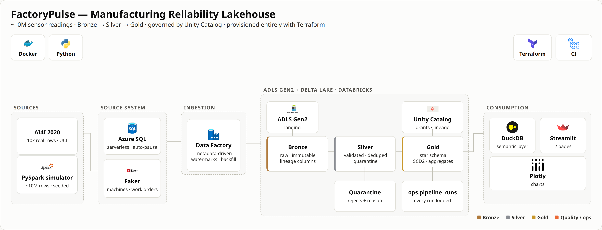

<h1 align="center">FactoryPulse</h1>

<p align="center">
  <b>A production-grade manufacturing reliability lakehouse on Azure. ~10M sensor readings from
  20 machines across 2 plants — ingested incrementally, modelled into a star schema with SCD Type 2
  history, governed by Unity Catalog, and surfaced through a tested Python dashboard that
  tells a plant manager which machine to fix first.</b>
</p>

<p align="center">
  
  
  
  
  
  
  
  
  
  
  
  
</p>

<p align="center">
  <a href="https://github.com/Mohamed-Elsafty23/FactoryPulse/actions/workflows/ci.yml">
    </a>
</p>

---

## Table of Contents

- [Pipeline Architecture](#pipeline-architecture)
- [Animated Pipeline Walkthrough](#animated-pipeline-walkthrough)
- [Dashboard](#dashboard)
- [Data Model](#data-model)
- [Tech Stack](#tech-stack)
- [How Data Flows](#how-data-flows)
- [Medallion Architecture](#medallion-architecture)
- [The Data](#the-data)
- [Measured Results](#measured-results)
- [Infrastructure as Code](#infrastructure-as-code)
- [Data Quality](#data-quality)
- [Design Decisions Worth Reading](#design-decisions-worth-reading)
- [Known Limitations](#known-limitations)
- [Project Structure](#project-structure)
- [Quick Start](#quick-start)
- [Cost](#cost)
- [Guides](#guides)
- [License](#license)

---

## Pipeline Architecture

<p align="center">
  
</p>

> Full data flow: AI4I 2020 + a seeded PySpark simulator → Azure SQL → Azure Data Factory
> (metadata-driven, watermarked) → ADLS Gen2 → Databricks (Bronze → Silver → Gold Delta) →
> DuckDB + Streamlit. Governed by Unity Catalog, provisioned entirely with Terraform.

---

## Animated Pipeline Walkthrough

<p align="center">
  <a href="docs/diagrams/pipeline_animated.webm">
    
  </a>
</p>

<p align="center"><i>Click for the full-quality <a href="docs/diagrams/pipeline_animated.webm">WebM</a>,
or the <a href="docs/diagrams/pipeline_animated.mp4">MP4</a>. Rendered from
<a href="docs/diagrams/pipeline_animated.html">HTML</a> — not screen-recorded — so it is
version-controlled and re-renders with one command. The static diagram above is captured from the
same source file, so the two cannot drift apart.</i></p>

---

## Dashboard

**Three pages, built on a unit-tested semantic layer** — no login, no Azure, no BI licence.
It reads the committed Parquet in `exports/`, so it keeps working after the cloud is torn down.

<details>
<summary><b>What each page answers</b></summary>

- **Plant Manager** — Is this period worse than the last, and which machine do I send someone to?
  Five KPI tiles with prior-period deltas, downtime trend, failure Pareto, and machines ranked
  by **cost** rather than hours.
- **Reliability** — Where should engineering focus? Pareto of failure modes, failure rate by
  shift and plant, and machines with recurring failures.
- **Machine Detail** — Drill-down to one machine, including its **SCD Type 2 version history**.

Every chart has a **table view** toggle, and the palette is validated for colour-vision
deficiency rather than eyeballed.
</details>

```bash
pip install -e ".[dashboard]" && make dashboard    # http://localhost:8501
```

---

## Data Model

| Table | Grain | Rows |
|---|---|--:|
| `fact_machine_event` | one sensor reading per machine per minute | 9,896,841 |
| `fact_downtime` | one continuous non-producing interval per machine | 100,228 |
| `fact_work_order` | one maintenance work order | 2,256 |
| `agg_machine_daily` | one machine per day — KPI **components**, not ratios | 6,960 |
| `dim_machine` | **SCD Type 2** — one row per machine per version | 21 (20 machines) |
| `dim_date` / `dim_plant` / `dim_shift` / `dim_failure_type` | conformed dimensions | 457 / 2 / 3 / 6 |

Grain is written as a **table comment** on every fact, so it travels with the data into Unity
Catalog, `DESCRIBE`, and catalog search.

---

## Tech Stack

| Layer | Technology | Purpose |
|---|---|---|
| **Source data** | AI4I 2020 (UCI) | 10k real rows — sensor distributions + failure taxonomy |
| **Simulation** | PySpark, seeded | expands to ~10M rows with injectable defects |
| **Source system** | Azure SQL Database | serverless, auto-pause; triggers maintain the watermark |
| **Ingestion** | Azure Data Factory | ONE metadata-driven pipeline, N tables, + backfill |
| **Storage** | ADLS Gen2 | hierarchical namespace — atomic renames for Delta commits |
| **Compute** | Azure Databricks (Premium, **serverless** jobs) | 2–4 s task start-up, nothing left running |
| **Table format** | Delta Lake | ACID, MERGE, time travel, schema enforcement |
| **Governance** | Unity Catalog | dev/prod catalogs, 3 personas, comments, column lineage |
| **Orchestration** | Databricks Workflows | 5-task DAG, fail-fast, schedule paused by default |
| **Semantic layer** | DuckDB + Python | SQL over Parquet — **unit-tested**, unlike DAX |
| **Dashboard** | Streamlit + Plotly | 3 pages + drill-down, validated palette |
| **IaC** | Terraform | 69 resources, the entire Azure platform, `plan` clean |
| **CI** | GitHub Actions | ruff + pytest on local Spark — **no cloud dependency** |
| **Local dev** | Docker Compose | Postgres + MinIO stand in for Azure SQL + ADLS |

---

## How Data Flows

| Step | Component | What happens |
|---|---|---|
| 1 | **AI4I + simulator** | 10k real rows supply the distributions; a seeded PySpark job expands them to ~10M readings with injected defects |
| 2 | **Azure SQL** | Machines, work orders and production orders. A trigger advances `updated_at` on every write — the watermark ADF trusts |
| 3 | **Data Factory** | One parameterised pipeline reads `ops.ingestion_control` and copies only rows inside a **closed watermark window** |
| 4 | **ADLS Gen2** | Parquet lands Hive-partitioned; the watermark advances **only on Success** |
| 5 | **Bronze** | Raw and immutable. Four lineage columns added, nothing else |
| 6 | **Silver** | Contextual validation rules; rejects go to **quarantine with a reason**; deterministic dedup |
| 7 | **Gold** | Star schema. SCD2 `dim_machine` via Delta MERGE; downtime intervals built with gaps-and-islands |
| 8 | **Dashboard** | DuckDB queries committed Parquet; Streamlit renders it — with Azure switched off |

**Orchestration:** Databricks Workflows (bronze → silver → scd2 → gold → quality),
scheduled but **paused** by default as deliberate cost control.

**Every Azure resource above is managed by Terraform.**

---

## Medallion Architecture

```
 SOURCES              BRONZE                SILVER                   GOLD                CONSUMPTION
┌───────────┐   ┌──────────────┐   ┌──────────────────┐   ┌──────────────────────┐   ┌─────────────┐
│ AI4I 2020 │──→│ telemetry    │──→│ telemetry        │──→│ fact_machine_event   │──→│ DuckDB      │
│ simulator │   │ machines     │   │ work_orders      │   │ fact_downtime        │   │ Streamlit   │
│ Azure SQL │   │ work_orders  │   │ production_orders│   │ fact_work_order      │   │ Plotly      │
│ (via ADF) │   │ plants       │   │                  │   │ dim_machine (SCD2)   │   └─────────────┘
└───────────┘   │              │   │   ↓ rejects      │   │ dim_date/plant/shift │
                │ raw +        │   │ ┌──────────────┐ │   │ agg_machine_daily    │
                │ lineage cols │   │ │ quarantine   │ │   └──────────────────────┘
                └──────────────┘   │ │ + reason     │ │
                                   │ └──────────────┘ │
                                   └──────────────────┘
                     ops.pipeline_runs — every run, on success AND failure
```

---

## The Data

- **AI4I 2020 Predictive Maintenance** (UCI, CC BY 4.0) — 10,000 **real** rows. Supplies sensor
  distributions and the five-mode failure taxonomy.
- **Simulated telemetry** (~10M rows) — 20 machines, 2 plants, 3 shifts, ~12 months at 1-minute
  resolution. **Failure logic implements the documented AI4I generative rules**, not noise.
- **Injected defects** — duplicates, out-of-range values, orphan foreign keys, missing
  fields. Deliberate, so the quality gates are genuinely tested.

### Simulation fidelity — stated honestly

The simulator models sensors as jointly normal with a fixed linear correlation measured from the
source, then applies the published AI4I threshold rules. That reproduces the **per-reading failure
rate** closely, but it is a per-reading model, and that has a consequence described plainly under
[Known Limitations](#known-limitations): the derived *reliability* KPIs (MTBF, availability)
are not plant-realistic, because a per-observation probability is being applied once per minute.

The pipeline, the star schema, the SCD2 history and the quality gates are all exercised correctly
by this data — only the business plausibility of the headline KPI values is affected.

---

## Measured Results

Captured from a green end-to-end run on 2026-10-19. Nothing here is estimated.

| Metric | Value |
|---|--:|
| Telemetry rows into Bronze | 10,049,501 |
| Rows surviving to Silver | 9,896,841 |
| Removed in Silver (rejects + dedup) | 152,660 |
| `fact_machine_event` rows | 9,896,841 |
| **Silver → Gold reconciliation** | **exact match** |
| `fact_downtime` intervals | 100,228 |
| Bronze → Silver → SCD2 → Gold → quality, end to end | **6 m 37 s** |
| Serverless task start-up | 2–4 s |
| Data-quality checks passing | **10 / 10** |
| Automated tests | **59 passing** |
| **Partition pruning speed-up** | **1.40×** (0.734 s → 0.524 s) |
| Terraform-managed resources | 69 |
| **Total Azure spend** | **$3.24** of a $200 credit |
| Dashboard hosting cost | **$0** |

See [docs/benchmarks.md](docs/benchmarks.md) for method, hardware and the physical plan that
explains the pruning result — including why it is 1.4× and not 10×.

---

## Infrastructure as Code

```bash
make tf-apply-stage1   # first run only — bootstraps the Databricks workspace
make tf-apply          # everything else
make tf-destroy        # billing stops
```

<details>
<summary><b>What is and is not in Terraform — and why</b></summary>

| Managed by Terraform | Deliberately NOT managed |
|---|---|
| Resource group, budgets (created **before** any billable resource, enforced by `depends_on`) | **ADF pipeline activities** — JSON in `infra/terraform/adf_pipelines/`, deployed via `activities_json`. Nested activity JSON in HCL is unreadable. |
| ADLS Gen2 + filesystem + directories | **Database schema and seed data** — that is data, not infrastructure |
| Key Vault + generated secrets + RBAC | **The dashboard** — a Python app in this repo |
| Azure SQL (serverless) + firewall rules | **Databricks account-level groups** — needs separate account auth |
| Data Factory + linked services + datasets + pipelines | |
| Databricks workspace, cluster, job, secret scope, volume | |
| Unity Catalog: credentials, locations, catalogs, schemas, **grants** | |

**Known Terraform limitations, stated rather than hidden:**

- **Two-stage first apply.** The `databricks` provider is configured with the workspace URL,
  which does not exist until the workspace is created — and Terraform configures providers
  *before* walking the dependency graph. A larger team splits this into two root modules with
  `terraform_remote_state`; that was judged more machinery than a solo project needs.
- **Local state containing secrets.** `random_password` values land in `terraform.tfstate` in
  plaintext. State is gitignored. A team would use an encrypted `azurerm` backend with locking.
- **`time_sleep` for RBAC propagation.** Azure role assignments take 30–120 s to take effect and
  Terraform has no native wait. Standard practice, but a workaround.
- **Job task blocks are declared alphabetically**, because the provider reads them back sorted.
  Declaring them in DAG order produces a permanent cosmetic diff on every `plan`.

</details>

---

## Data Quality

**10 automated checks**, run on every pipeline execution and in CI:

| # | Check | Catches |
|---|---|---|
| 1 | `event_id` uniqueness | failed dedup inflating every SUM |
| 2 | `machine_id` foreign-key integrity | facts that vanish from grouped reports |
| 3 | Sensor values within physical ranges | faults masquerading as measurements |
| 4 | No negative durations | clock skew making MTTR flatteringly low |
| 5 | `failure_type` in the accepted enum | upstream schema drift |
| 6 | No duplicate rows after dedup | dedup silently doing nothing |
| 7 | **Silver → Gold row reconciliation** | point-in-time join fan-out *or drop-out* |
| 8 | **SCD2 — no overlapping intervals** | double-counted measures |
| 9 | **SCD2 — exactly one current row per machine** | machines missing from "today" |
| 10 | **Idempotency** — re-running leaves counts unchanged | retries corrupting totals |

Checks 7 and 9 both earned their keep during the Azure port: 7 caught a point-in-time join that
silently dropped 2.6M rows, and 9 caught a machine left with two open SCD2 versions. Both are
invisible without the check — no error is raised, the numbers are just wrong.

Rejected rows are **quarantined with a reason**, never dropped:

```sql
SELECT reject_reason, COUNT(*) FROM quarantine.telemetry GROUP BY 1 ORDER BY 2 DESC;
```

Every run — **success and failure** — writes a row to `ops.pipeline_runs` with rows read,
written, rejected, duration, freshness and the git SHA that produced it.

---

## Design Decisions Worth Reading

- **[ADR log](docs/decisions.md)** — every non-obvious choice and its alternatives.
- **MTBF is non-additive** and is computed as a ratio of sums at query time. The Gold layer
  stores *components*, not ratios, which makes the common bug structurally impossible — and
  `tests/test_metrics.py::test_mtbf_is_non_additive` **fails CI** if anyone breaks it. *(This
  is the single clearest advantage of a code semantic layer over DAX.)*
- **SCD2 validity comes from the source change time, not load time.** `ops.machines.updated_at`
  dates each version; the earliest version is anchored at the beginning of time, because a full
  extract shows current state and says nothing about what came before. Anchoring it at load time
  instead puts every fact before `valid_from` and empties the fact table — which is exactly what
  happened, and is now locked down by three regression tests.
- **Validation rules are contextual.** A stopped machine legitimately reports 0 rpm, so range
  checks are scoped to running machines. Without that, valid rows would be quarantined and
  `fact_downtime` would be empty.
- **Watermarks advance only on Success**, never on Completion. Advancing on completion would
  silently and permanently skip rows — the classic incremental-ingestion data-loss bug.
- **Closed watermark windows.** The upper bound is captured *before* the copy, so a batch is
  deterministic and a retry is safe.
- **Overwrite mode is set per-write, not on the session.** Databricks serverless rejects
  `spark.sql.sources.partitionOverwriteMode`, and ambient session state is a poor place for a
  correctness-critical setting anyway.
- **No dual-axis charts.** The Pareto indexes both series to % of total so they share one axis,
  rather than implying a relationship between two arbitrarily aligned scales.
- **Three weeks local before any cloud spend.** The early phases run entirely on Docker.

---

## Known Limitations

Stated deliberately rather than discovered by a reviewer:

- **The headline reliability KPIs are not plant-realistic.** The simulator applies AI4I's
  ~3.4% failure rate *per minute-reading*, but in the source dataset that rate is per discrete
  manufacturing observation, not per minute of runtime. The consequence is a failure roughly
  every 29 minutes per machine and, with 15–120 minute repairs, machines DOWN ~70% of the time:
  fleet MTBF reads 0.12 h and availability 9.5% where a real plant would be 200–400 h and
  85–95%. The data is internally consistent (`running_minutes + downtime_minutes = reading_count`)
  and every pipeline mechanism — star schema, SCD2, gaps-and-islands, the quality gates — is
  exercised correctly by it. Fixing it means converting the per-observation probability into a
  per-minute hazard and regenerating the dataset; it is a simulator modelling choice, not a
  pipeline defect.
- **Freshness SLA.** The dataset is a historical simulation, so measured freshness reflects the
  simulation window rather than pipeline lag. The mechanism is implemented; the absolute value
  is not meaningful. See ADR-004.
- **Quarantine is append-only**, so re-running Silver re-appends the same rejects — the 310,944
  rows there span several runs, not one. Distinguishable via `_quarantine_batch`. Production
  would partition by batch or MERGE on a key.
- **ADF uses `SELECT *`**, so a source column rename reaches Bronze before anything objects.
  Caught at the SCD2 boundary by a schema contract, but an explicit column list would catch it
  a layer earlier.
- **Seeding is row-by-row.** Bulk loading would fix it; not required at this scale.
- **OEE** is computed, but ideal cycle times are simulated constants per machine model, not
  measured values.
- **The dashboard is not self-service.** Power BI would give business users their own views and
  row-level security. Python was chosen for reproducibility, testability and survivability —
  a deliberate trade, not an oversight.
- **`fact_machine_event` is not committed** (~165 MB). Regenerate with `make simulate` — the
  simulator is seeded and reproducible. The aggregates and dimensions are in `exports/`.

---

## Project Structure

```
factorypulse/
├── infra/
│   ├── terraform/              # the ENTIRE Azure platform as code
│   │   └── adf_pipelines/      # ADF activity JSON (deployed via activities_json)
│   └── docker/                 # local Postgres + MinIO stack
├── src/factorypulse/
│   ├── config.py               # the ONE place that knows local paths from Azure paths
│   ├── spark.py                # session builder — the only module that knows about JARs
│   ├── simulator/              # AI4I profiling, telemetry generation, defect injection
│   ├── pipeline/               # bronze, silver, scd2, gold, dimensions
│   ├── quality/                # validation rules, schema contract, the 10 checks
│   ├── dashboard/              # data (DuckDB), metrics (semantic layer), theme, charts
│   └── utils/                  # run context, ops table
├── app/                        # Streamlit dashboard (Home.py + pages/)
├── notebooks/                  # thin Databricks wrappers over src/
├── tests/                      # unit + data-quality + metrics tests (no cloud needed)
├── sql/                        # Postgres and Azure SQL (T-SQL) schemas
├── exports/                    # Gold tables as Parquet — explorable without Azure
├── scripts/                    # deploy, benchmarks, profiling, env bridging
└── docs/
    ├── build/                  # the phase-by-phase build guide
    ├── diagrams/               # architecture + animated walkthrough (HTML source)
    ├── decisions.md            # ADRs
    ├── kpi_dictionary.md       # formula, owner, refresh, German term per KPI
    ├── metrics.md              # the semantic layer, and why each metric is written that way
    ├── data_provenance.md      # what is real, what is simulated
    └── benchmarks.md           # measured numbers + mechanism
```

---

## Quick Start

### Run everything locally — no Azure, no cost

```bash
git clone https://github.com/Mohamed-Elsafty23/FactoryPulse && cd FactoryPulse
make setup                       # venv + deps + pre-commit
make up                          # Postgres + MinIO
make seed                        # reference data
python -m factorypulse.simulator.change_events   # SCD2 change events
make simulate ROWS=1000000       # 1M rows for a quick run
factorypulse run                 # bronze -> silver -> scd2 -> gold -> quality
make quality                     # the 10 checks
```

Requires Python 3.10–3.13, **Java 17**, Docker.

### Run the dashboard

```bash
pip install -e ".[dashboard]"
make dashboard                   # http://localhost:8501
```

It reads the committed Parquet in `exports/`, so it works with Azure completely deleted.

### Deploy and run on Databricks

```bash
make dbx-deploy                  # build wheel, upload, import notebooks, sync the job
make dbx-run                     # ...then trigger the medallion job and wait for it
make exports                     # pull the Gold snapshot back down for the dashboard
```

Authentication is your Azure CLI identity exchanged for a Databricks token — no PAT on disk.

### Explore the data with no setup at all

```python
import pandas as pd
pd.read_parquet("exports/gold_fact_downtime/")
pd.read_parquet("exports/ops_pipeline_runs/")
```

---

## Cost

Total: **$3.24** of a $200 Azure credit, as of 2026-10-19.

| Service | Cost |
|---|--:|
| Azure SQL (serverless, auto-pause) | $2.16 |
| Data Factory (activity runs) | $1.08 |
| ADLS Gen2 (Standard LRS, ~1 GB) | $0.00 |
| Azure Databricks (serverless jobs) | $0.00 * |
| **Dashboard hosting** | **$0.00** |

\* Databricks serverless usage is reported on a lag, so the figure above understates the final
Databricks line. It is small by construction: job compute is created per run and destroyed
afterwards, so nothing can be left running, and the all-purpose cluster carries a 10-minute
auto-termination enforced by a Terraform `validation` block that refuses any value above 30.

Budget alerts were created **before the first resource** — enforced in Terraform via
`depends_on`, so the order cannot be got wrong.

The early phases ran entirely locally at zero cost.

---

## Guides

| Document | Contents |
|---|---|
| **[Build guide](docs/build/00_START_HERE.md)** | Every phase, each step explained with the concept behind it |
| [KPI dictionary](docs/kpi_dictionary.md) | Formula, owner, refresh frequency, German term per KPI |
| [Semantic layer](docs/metrics.md) | Every metric and why it is written that way |
| [Data model](docs/data_model.md) | Bus matrix, fact grains, SCD2 design |
| [Data provenance](docs/data_provenance.md) | What is public, what is simulated, why |
| [Benchmarks](docs/benchmarks.md) | Measured numbers and their mechanism |
| [Decisions (ADRs)](docs/decisions.md) | Every non-obvious choice and its alternatives |

---

## License

Code: MIT. AI4I 2020 dataset: CC BY 4.0 (UCI Machine Learning Repository).
